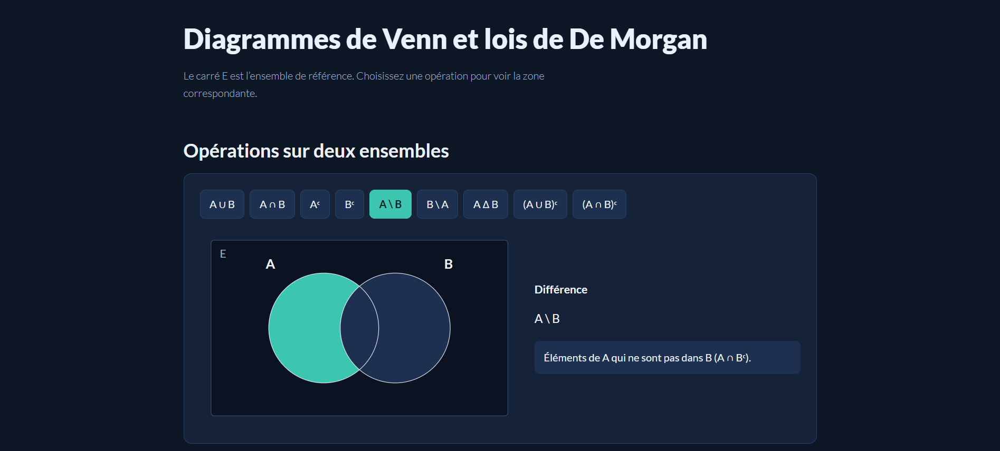
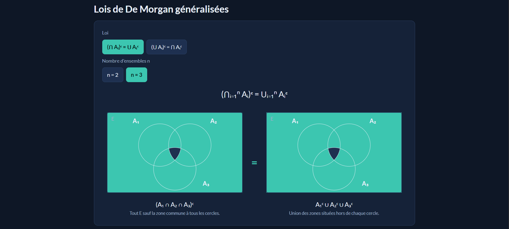

# Diagrammes de Venn et lois de De Morgan

Petit projet React  pour visualiser les operations sur les ensembles et les lois de De Morgan

## Aperçu





## Lancer le projet

```bash
npm install
npm run dev
```

## Contenu

- Operations : ∪, ∩, complementaire, difference, difference symetrique
- Lois de De Morgan : (⋂ Aᵢ)ᶜ = ⋃ Aᵢᶜ et (⋃ Aᵢ)ᶜ = ⋂ Aᵢᶜ, avec n = 2 ou 3 ensembles

---

by Abdelhak Ezzitouni